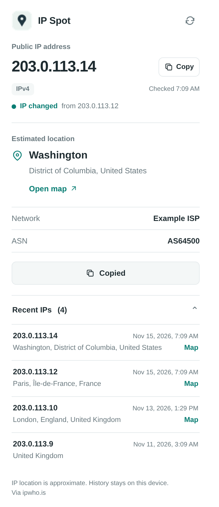

# IP Spot

A lightweight Chrome extension that shows your **public IP address**, its **approximate geographic location**, and a short **local history** of recent IP addresses.



## Features

- View your public IPv4 or IPv6 address, city, region, country, ISP, and ASN.
- Detect changes between consecutive successful IP lookups.
- Cache successful lookups for five minutes; use **Refresh** to bypass the cache.
- See when the current result was last checked.
- Copy the IP or copy all connection details, including timezone and coordinates.
- Save the five most recently observed **distinct** IP addresses locally with their last-known locations and dates.
- Open approximate coordinates in OpenStreetMap.
- Reuse the last-known cached result if the API fails while refreshing.
- Follow the system light/dark theme. No dependencies, accounts, or API keys.

## Install in Chrome

1. Open the [latest IP Spot release](https://github.com/MohamadrezaKhalvati/ip-spot/releases/latest).
2. Under **Assets**, download the `-chrome.zip` file (for example, `ip-spot-v2.1.1-chrome.zip`).
3. Extract the ZIP into a folder you intend to keep. **Do not select the ZIP itself** when loading the extension.
4. Open `chrome://extensions` in Google Chrome.
5. Enable **Developer mode** in the top-right corner.
6. Click **Load unpacked** and select the extracted folder containing `manifest.json`.
7. Pin **IP Spot** to the toolbar and click its icon to view your public IP and approximate location.

Chrome runs IP Spot directly from the extracted files; no build step is required.

### Update an existing installation

1. Download the newest `-chrome.zip` asset from [Releases](https://github.com/MohamadrezaKhalvati/ip-spot/releases/latest).
2. Extract it over the files in the **same folder** used for the existing unpacked extension.
3. Open `chrome://extensions` and click **Reload** on IP Spot.

Keep the same unpacked extension directory to preserve its Chrome extension identity. Your saved history is tied to that identity; removing and reinstalling the extension or changing its identity can clear or disconnect it.

## Run tests

Requires Node.js 22 or newer.

```bash
npm run verify
```

This runs JavaScript syntax checks and the dependency-free Node.js test suite. GitHub Actions runs the same command on pushes and pull requests.

## How it works

- **Manifest:** Chrome Extension Manifest V3.
- **Source:** Standard JavaScript ES modules and CSS; no bundled frameworks or remote code.
- **Lookup:** A request to `https://ipwho.is/` when the popup is opened with no fresh cache, or when you press Refresh.
- **Cache:** Five-minute TTL since the previous successful lookup.
- **History:** Up to five distinct IP addresses in `chrome.storage.local`. Revisiting an IP updates its location, timestamp, and ordering.
- **IP change detection:** Happens only when a lookup is performed. No background polling or notifications.
- **Maps:** OpenStreetMap links for returned valid geographic coordinates.

## Privacy and permissions

IP Spot requests only the `storage` permission and host access to `https://ipwho.is/*`. It does **not** request access to browsing history, tabs, or device GPS.

When a lookup occurs, your public IP and request metadata are visible to the third-party `ipwho.is` service. Clicking a map link opens OpenStreetMap, which also receives normal browser request metadata. Cache and history stay in Chrome's **local** extension storage; they are not synced by IP Spot. Chrome clears that storage when the extension is uninstalled. IP-based locations are approximate and can be affected by VPNs, proxies, cloud hosting, and ISP routing.

## Release notes

**v2.1.1**: Added geographic details, last-checked dates, and map links to the recent-IP history, with compatibility for existing v2.1 history entries.

**v2.1.0**: Added IP change detection, a five-minute cache, last-checked time, ASN, copy-all details, and five-entry history.

## License

Licensed under the [MIT License](LICENSE).

